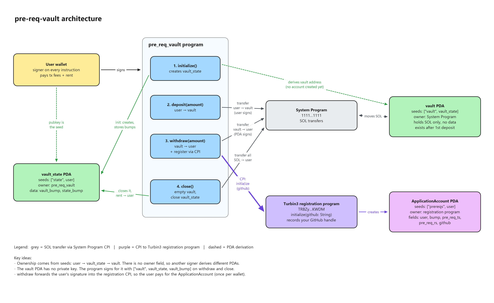
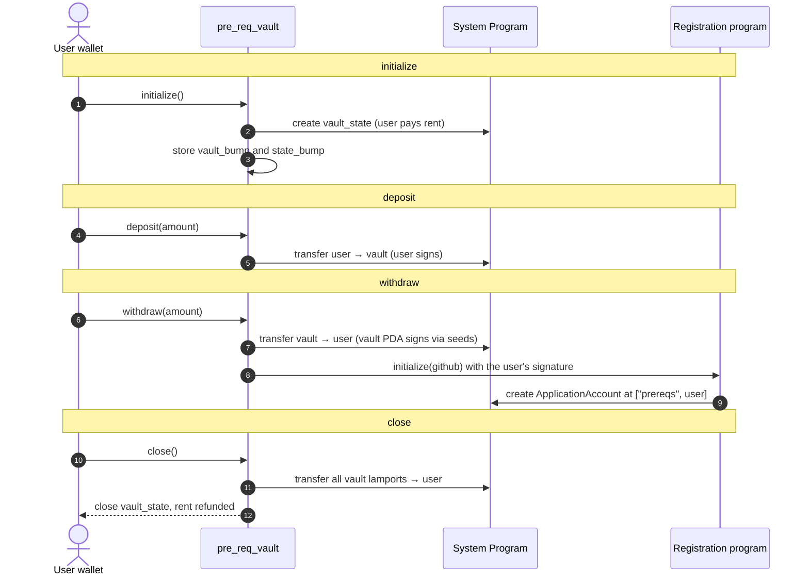

# pre-req-vault

A per-user SOL vault on Solana, built with Anchor, for the Turbin3 prerequisite challenge. Each wallet gets its own vault that it can initialize, deposit into, withdraw from and close. Withdrawing also makes a CPI to Turbin3's registration program, which records the user's GitHub handle on-chain.

- **Program ID (devnet):** `Hh5v2RX9ASZnmyog6HsEgeazZq5N3RqZFGXBKz97mKiw`
- **Video walkthrough:** <YOUTUBE_LINK>

## Architecture



The diagram was made in Excalidraw. The editable source is [docs/architecture.excalidraw](docs/architecture.excalidraw), which you can open at [excalidraw.com](https://excalidraw.com).

### Lifecycle



## Design notes

- **Ownership comes from the PDA seeds.** `vault_state` is derived from the user's pubkey, and `vault` is derived from `vault_state`, so no owner field is stored. A different signer derives different addresses and can't reach someone else's vault.
- **Two accounts, two jobs.** `vault_state` is a program-owned data account that holds the bumps. `vault` is a plain System account that only holds SOL, so it needs no data and no `init`. It exists once the first deposit funds it.
- **Bumps are stored once.** `initialize` saves both bumps, and the other instructions reuse them with `bump = vault_state.vault_bump` instead of searching for them again.
- **The program signs for the vault.** No private key exists for the vault PDA. On withdraw and close, the program signs the System Program transfer with `["vault", vault_state, vault_bump]`.
- **The registration CPI.** In `withdraw`, the program calls the registration program's `initialize` and forwards the user's signer privilege, so the user pays for the new `ApplicationAccount`. `seeds::program` checks that the account passed in is the correct registration PDA. That account can only be created once, so each wallet can register only once.
- **Rent edge case.** The vault must keep at least the rent-exempt minimum or hold exactly 0 lamports. A deposit too small to make it rent-exempt fails, and so does a withdrawal that would leave it below that minimum. `close` drains it to 0.

## Running

```bash
anchor build
anchor deploy --provider.cluster devnet
anchor test --skip-deploy
```

The TypeScript tests in `tests/pre-req-vault.ts` run initialize → deposit 1 SOL → withdraw 0.5 SOL (which registers you) → close against devnet.
